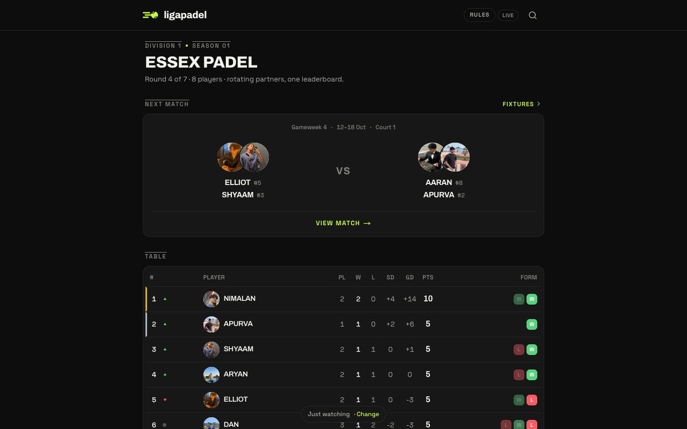
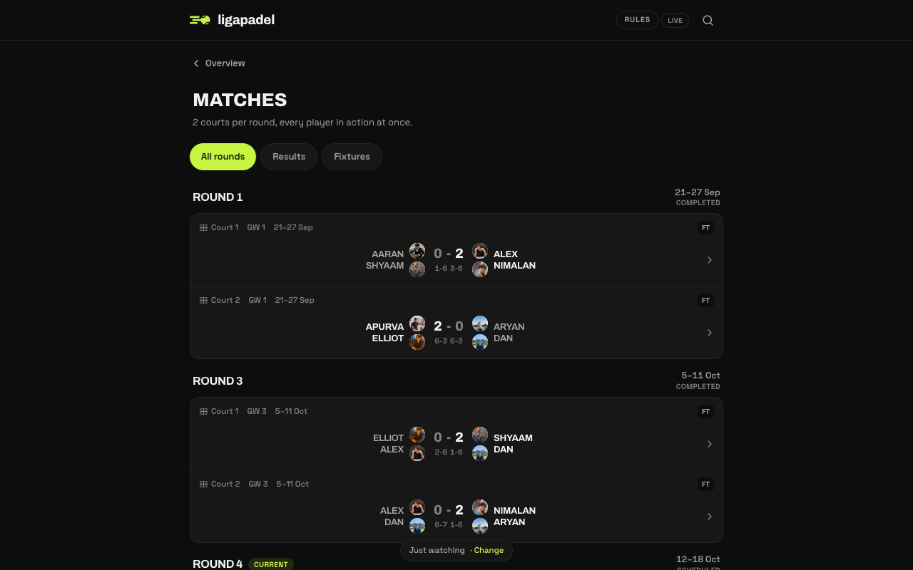
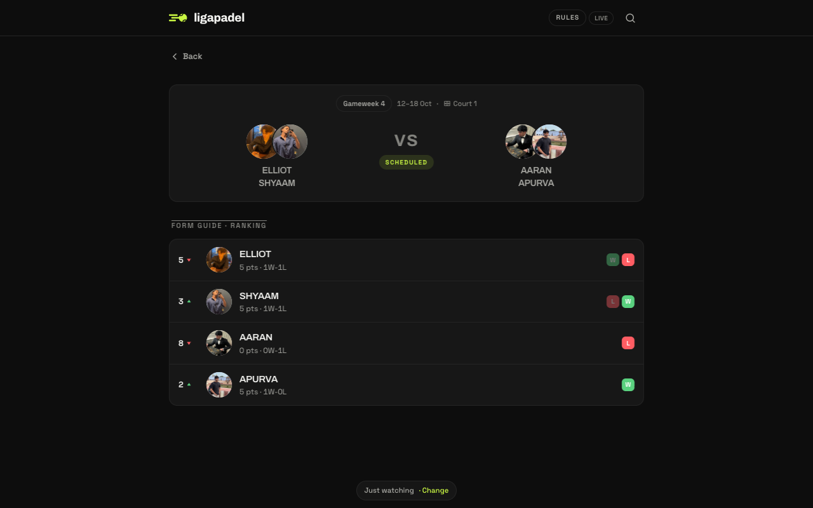

# Liga Padel

The league site for my padel group in Essex: eight players, rotating partners, one leaderboard. **[ligapadel.web.app](https://ligapadel.web.app)**

> The source code is private. This page describes the project.

## What it does

- **League table** with points, set difference and recent form.
- **Fixtures and results** for every round, two courts at a time.
- **Player pages** with each person's record.
- **Score reporting.** Any player can report a result by name, so I don't have to enter them all.
- **Win probability** for each game, learned from past results.
- **Rules page** covering set wins and tiebreaks.

  
  

## In progress

A WhatsApp bot that answers questions from live league data and helps pairs agree a time to play. It works in test mode. It is not switched on for the group yet, because WhatsApp requires approved message templates and a business number first.

## How it was built

Next.js and Firebase, built with AI coding tools. The bot runs as a Cloud Function and uses Claude to write replies.
